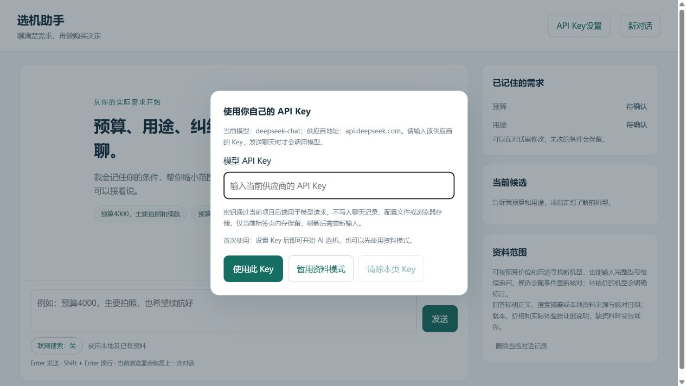

# 多轮选机对话 Agent

通过连续对话了解预算、用途和候选，允许修改条件；Agent按需调用本地资料、公开搜索与正文抓取，回答附来源。SQLite保存会话和条件，回复可查看工具调用过程。



本目录只运行对话助手。手机对比研究在独立工程 phone-comparison-agent 中维护，本项目运行和安装均不依赖该工程。

## 启动

需要 Python 3.12 或更新版本。下载 ZIP 并解压，或运行：

```powershell
git clone https://github.com/2049004750t-cmyk/phone-research-open-source.git
cd phone-research-open-source
```

```powershell
python -m venv .venv
.\.venv\Scripts\python.exe -m pip install -r requirements.txt
# 首次配置时复制；已有.env不要覆盖
Copy-Item .env.example .env
.\.venv\Scripts\python.exe -m uvicorn main:app --host 127.0.0.1 --port 8130
```

打开 http://127.0.0.1:8130/ 。安装后也可用 `phone-chat --port 8130`。

首次打开且没有配置模型时，首页会提示输入自己的 API Key；也可随时点击右上角“API Key设置”。默认模型为 `deepseek-chat`，使用 DeepSeek 的 Key；其他兼容服务需在本机 `.env` 配置 `MODEL_API_URL`、`MODEL_NAME`、`MODEL_PROVIDER`，页面会显示当前模型和供应商域名。下载者填写自己的 Key，不会获取项目作者的凭据。

网页输入的 Key 仅保留在当前标签页内存，刷新后需重新输入。只随聊天请求发送到当前项目后端，并在该请求内覆盖环境中的聊天模型 Key；不写入 `.env`、聊天记录、日志或浏览器存储，不会在用户 Key 失败时换用环境 Key。保存时只检查格式，不自动调用模型；首次聊天才验证供应商是否接受它。仅允许通过本机HTTP或HTTPS输入个人Key；远程托管仍须信任部署者，并配置网站访问密钥。此功能不是多用户账号隔离，独立的远程Embedding仍使用部署配置。

也可在本机 `.env` 配置 `MODEL_API_KEY` 供自己长期使用；不配置时使用标明的规则/资料兜底。`CHAT_STORAGE_PATH`默认是本目录`runs/chat-sessions.sqlite3`；拆分未移动原会话。

## 核心模块

- app/chat.py、app/chat_intent.py、app/conversation_policy.py：多轮会话、增量条件合并与路由。
- app/chat_answer.py：Agent 与离线模式共享的回答生成、引用/参数校验和资料摘录。
- app/chat_agent.py 的 ChatAgentRun：显式管理单轮状态；工具执行、来源登记、候选选择与收尾可独立调用。app/tool_loop.py 管理执行预算。
- app/phone_sources.py与app/public_search.py：独立公开资料工具，没有对比研究业务依赖。
- app/knowledge.py：完整机型过滤、BM25、持久化向量和RRF；默认随包BM25。
- app/local_embeddings.py、app/knowledge_ingest.py：可选本地语义向量和官方正文增量入库；默认无需模型下载或 Embedding 请求。
- app/config.py、app/topics.py、app/chat_prompts.py：统一配置解析、按职责区分的主题词表与模型提示词。
- app/chat_store.py：SQLite持久化、会话隔离与并发更新保护。

## 随包资料

默认加载 `app/knowledge_samples/selection_index.json`，包含 98 款、455 片段：385 个参数片段、57 个价格片段、13 个评测片段。索引不含向量，保留来源网址、核对日期与原始摘录；wheel 也携带此文件，克隆或安装后可直接使用 BM25。5 款初始候选目录与 98 款可检索资料是不同概念，Agent 可从资料发现其他型号。

```powershell
.\.venv\Scripts\python.exe -m app.knowledge_cli query --index app/knowledge_samples/selection_index.json --phone "iPhone 16 Pro" --need "相机"
```

`CHAT_KNOWLEDGE_INDEX_PATH` 可指定外部索引；本机现有 98 款/455 片段向量索引继续用于混合检索。其中只有16款有价格记录、5款有评测记录。复制索引不刷新价格或补足实测，也不代表逐项事实已通过人工复核。旧的两份小样本 JSONL 与虚构 Phone A/B 仍供开发测试使用，不进入运行 wheel。

## 验证与用户出题

```powershell
.\.venv\Scripts\python.exe -m pytest -q
node --test tests/test_chat_ui.cjs
.\.venv\Scripts\python.exe -m scripts.evaluate_chat --output-directory runs/chat-acceptance-new
.\.venv\Scripts\python.exe -m scripts.evaluate_intent --output runs/intent-new.json
```

公开版包含可复现的离线机制测试及开发回归题，见 [评测说明](evaluation/README.md)。私人真实对话、失败夹具及其依赖测试、历史输出与人工评审未随仓库公开；本地原件保留。测试项数和检索指标不代表真实问答准确率；当前没有独立盲测通过结论。

[聊天协议](docs/CHAT.md) · [架构](docs/ARCHITECTURE.md) · [Agent](docs/AGENT.md) · [RAG](docs/RAG.md) · [Embedding](docs/EMBEDDING.md) · [拆分记录](docs/PROJECT_SPLIT.md)

## 当前边界

随包档案有日期与规模限制，价格及实测需要核对；没有证据不推断体验。Agent有工具/模型/上下文预算，会保留错误和停止原因。已接入访问密钥、持久化请求/模型调用与token上限；远程访问未配置密钥会被拒绝。发布检查记录见 [验证说明](evaluation/README.md)；单轮期限也不是严格的进程中断保证。

## 访问和消费边界

本机默认无需访问密钥。远程监听必须设置 `CHAT_ACCESS_TOKEN`，页面的访问密钥仅存本次标签页的 sessionStorage，不写入会话或URL。`phone-chat --host 0.0.0.0` 和 Docker 入口会检查密钥；API也拒绝未配置密钥的远程会话操作。共享密钥面向单用户演示，不提供多用户账户隔离。

默认每IP每分钟6次聊天请求、全局每天100轮、200次模型请求、600000 token。通过 `.env.example` 中 `CHAT_RATE_LIMIT_PER_MINUTE`、`CHAT_DAILY_TURN_LIMIT`、`CHAT_DAILY_MODEL_CALLS`、`CHAT_DAILY_TOKEN_LIMIT` 调整；0关闭对应限制。每日按UTC+8零点切换，SQLite跨进程原子预留；未知usage和中断保留保守预留，有usage只结算一次。远程Embedding批次也受全局模型调用与token限制，本地Embedding不计付费请求。token预算用于限制消费，不代表人民币账单结算或其他工程的账户总费用。

## 可复现验证

```powershell
.\.venv\Scripts\python.exe -m scripts.audit_chat_corpus --index app/knowledge_samples/selection_index.json --output runs/corpus-audit-new.json
.\.venv\Scripts\python.exe -m app.knowledge_cli vectorize --input app/knowledge_samples/selection_index.json --output runs/index-vector-new.json
```

向量化默认只允许已准备好的本地模型；远程Embedding需显式 `--allow-remote`。来源编号、日期和原文不因向量化改变。

`scripts/evaluate_sealed_chat.py` 支持先seal再run：锁定题目、业务代码、脚本和初始知识快照；实际运行需 `--live`，调用总上限在seal时确定，运行标记独占创建，失败或中断不能在同目录重跑。结果保留原始请求、输出、来源、用量和失败，人工评审始终待填。开发者编写或看过的题属于回归集；external标签只记录题目来源声明，不能自动证明盲测。独立题由其他人准备并在实现冻结后交给评测工具。
