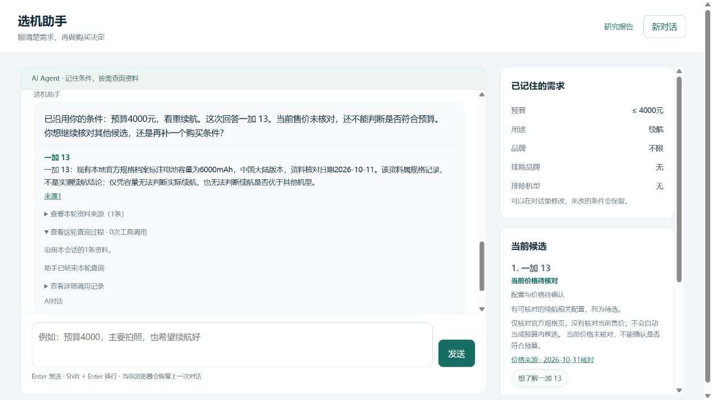
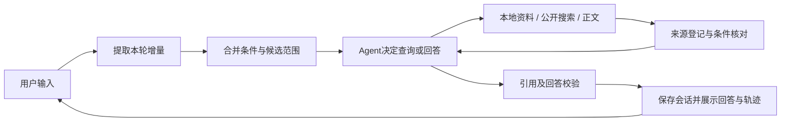

# 多轮选机对话 Agent

[](https://github.com/Love-burgers/phone-research-open-source/actions/workflows/tests.yml)

从预算、用途开始聊，逐步缩小候选范围。可以追问某款、修改或取消条件、重新推荐，也可以指定几款比较。回答附同机型来源，查询过程可展开查看，SQLite 保存会话与条件。



上图为历史真实模型对话截图，展示追问与资料边界，仍含拆分前入口。本版条件修改和候选更新已通过离线回归；该截图不是本版完整多轮验收，不代表实时售价或推荐质量。

## 核心能力

- 记住预算、用途、品牌、排除项、游戏、数量及具体要求，后续只改用户新说的条件。
- 区分临时追问与固定比较名单。修改预算重新核对，明确推荐释放旧名单，换一批暂避上一批。
- 模型按需选择本地检索、公开搜索、正文抓取及结束时机，工具次数、上下文和消费有边界。
- 分开处理满足、不满足、未知与来源冲突，缺证据的线索不占合格推荐名额。
- 来源标明正文/摘要、本地/联网、地区和日期；工具轨迹保留失败与停止原因。



## 多轮使用例

以下是可自行输入的完整操作示例，描述应检查的状态变化，不是模型逐字输出或真实质量验收记录。

| 轮次 | 输入 | 检查点 |
|---|---|---|
| 1 | 预算4500，主要玩游戏，推荐三款 | 记录预算与用途，核对版本价和游戏依据；不足时少给 |
| 2 | 第一款的屏幕怎么样？ | 按上轮展示顺序追问，保留条件，不固定后续选机范围 |
| 3 | 预算改为6000，给我推荐三款游戏手机 | 按新条件筛选，候选可更新，无需额外说“重新选” |
| 4 | 不要曲面屏，需要无线充电 | 新增硬条件；排除不符合的，说明未知或来源冲突 |
| 5 | 取消无线充电要求 | 取消对应条件，保留预算、游戏与屏幕要求 |
| 6 | 只比较第一款和第二款 | 固定当前展示顺序对应的比较名单 |
| 7 | 预算降到4000，这两款怎么取舍？ | 仍讨论指定名单，明确超预算或资料缺口 |
| 8 | 取消机型范围，按这些条件再推荐 | 释放名单，保留其他条件；刷新后可恢复会话 |

## 启动

```powershell
git clone https://github.com/Love-burgers/phone-research-open-source.git
cd phone-research-open-source
python -m venv .venv
.\.venv\Scripts\python.exe -m pip install -r requirements.txt
# 首次配置时复制；已有 .env 不要覆盖
Copy-Item .env.example .env
.\.venv\Scripts\python.exe -m uvicorn main:app --host 127.0.0.1 --port 8130
```

打开 [本地首页](http://127.0.0.1:8130/)。安装后也可用 `phone-chat --port 8130`。本项目独立运行，手机对比研究另有独立工程，不是安装依赖。

### 模型与 API Key

默认聊天模型为 `deepseek-chat`。首次打开且没有配置时，可在首页填写自己的 DeepSeek Key，或暂用资料模式。其他兼容服务在本机设置 `MODEL_API_URL`、`MODEL_NAME`、`MODEL_PROVIDER`；页面显示当前模型和供应商域名。


网页 Key 仅存当前标签页内存，刷新后需重新输入；只随聊天请求发送到当前后端，在该请求内覆盖环境 Key，不写入 `.env`、聊天记录、日志或浏览器存储。保存只检查格式，首次聊天才请求供应商；失败不会换用环境 Key。也可在本机 `.env` 设置 `MODEL_API_KEY`。个人 Key 只允许通过本机 HTTP 或 HTTPS 输入；远程部署仍需信任部署者。独立远程 Embedding 使用部署配置。

### 访问和消费控制

本机默认无需访问密钥。远程监听必须设置 `CHAT_ACCESS_TOKEN`，CLI、Docker入口和API均检查。页面访问密钥仅存本标签页 sessionStorage，不写入会话或 URL。共享密钥适用于单用户演示，不提供多用户登录与账户隔离。

默认每 IP 每分钟 6 次聊天请求；全局每天 100 轮、200 次模型请求、600000 token。通过 `.env.example` 的 `CHAT_RATE_LIMIT_PER_MINUTE`、`CHAT_DAILY_TURN_LIMIT`、`CHAT_DAILY_MODEL_CALLS`、`CHAT_DAILY_TOKEN_LIMIT` 调整，0关闭对应限制。每日按 UTC+8 切换，SQLite 原子预留；未知 usage 和中断保留保守预留，有用量时只结算一次。远程 Embedding 也计入模型调用与token限制，本地 Embedding 不计付费请求；这些控制不是人民币账单结算。

## 随包资料与检索

默认 `app/knowledge_samples/selection_index.json` 为无向量 BM25 索引：**102款、478片段**（389参数、73价格、16评测）；20款有价格记录、7款有评测。五款初始候选目录与可检索范围不同，Agent 可从资料发现其他型号。资料覆盖会影响可核实候选，不能将资料丰富的少数型号当成全市场最优。

```powershell
.\.venv\Scripts\python.exe -m app.knowledge_cli query --index app/knowledge_samples/selection_index.json --phone "iPhone 16 Pro" --need "相机"
```

补录复用官网采集器取得四个页面，另核对两篇原始评测。来源、版本、建议零售价、日期、优惠与实测范围见 [资料覆盖说明](docs/CORPUS.md)。未知与不符合分开处理，档案不自动刷新售价或证明库存。

默认无需模型下载或 Embedding 请求。可选本地 BGE 已接入运行路径；`CHAT_KNOWLEDGE_INDEX_PATH` 指向外部向量索引，配合 `EMBEDDING_PROVIDER=local` 和 `CHAT_RETRIEVAL_METHOD=hybrid` 使用。外部旧索引不会自动得到本次随包补录。配置见 [RAG](docs/RAG.md)、[Embedding](docs/EMBEDDING.md)。虚构 Phone A/B 仅用于开发测试，不进入运行 wheel。

## 验证与开发

### 网页查询模式

| 页面选择 / API | 行为 |
|---|---|
| 关闭查询 / `local` | 不发起新的公开搜索或网页读取；继续合并本地检索与会话中已保存的网页正文 |
| 按需查询 / `auto` | 允许Agent按当前问题的证据缺口决定补查，不强制每轮访问网页 |
| 本轮查询 / `web` | 请求本轮至少尝试一次公开查询；成功、缓存、失败或未执行分别展示，不等于强制刷新 |

页面默认关闭公开查询，API省略模式仍为auto，旧local/web请求继续兼容。用户明确“不要联网/只用已有资料”优先。关闭网页查询不等于关闭聊天模型或完全断网：DeepSeek及选配的远程Embedding仍可能请求各自服务，默认BM25和本地BGE无需远程Embedding。

刷新某类资料可直接说“刷新最新价格”。旧价格会保留核对日期和刷新状态，失败不删除配置、评测或来源入口，也不把历史价冒充最新价。详情、询价、推荐、换批的失败回答分别保留当前任务。实现与验证见 [联网与本地联合修复](docs/NETWORK_REPAIR_20261024.md)。

```powershell
.\.venv\Scripts\python.exe -m pytest -q
node --test tests/test_chat_ui.cjs
.\.venv\Scripts\python.exe -m scripts.check_public_docs
.\.venv\Scripts\python.exe -m scripts.evaluate_chat --output-directory runs/chat-acceptance-new
.\.venv\Scripts\python.exe -m scripts.evaluate_intent --output runs/intent-new.json
.\.venv\Scripts\python.exe -m scripts.audit_chat_corpus --index app/knowledge_samples/selection_index.json --output runs/corpus-audit-new.json
```

[已核验的远端CI](https://github.com/Love-burgers/phone-research-open-source/actions/runs/39953196441) 中 Ubuntu、Windows 和 container 均成功，包含 Docker 构建与 `phone-chat --help`；这不是容器完整聊天验收，也不覆盖尚未推送的本地修改。本轮范围见 [修复记录](docs/REPAIR_20261024.md)。

离线测试阻断外部网络，以假模型/资料验证状态和证据机制，不称作真实推荐质量验收。真实运行先限定场景与总调用数，失败、来源、轨迹和用量原样保留。封存评测要求见 [验证说明](evaluation/README.md)。私人会话、原始输出和人工评审不随公开清单发布。

## 实现与边界

[聊天协议](docs/CHAT.md) · [Agent](docs/AGENT.md) · [架构](docs/ARCHITECTURE.md) · [拆分记录](docs/PROJECT_SPLIT.md) · [待发布清单](docs/PUBLISH_CHECKLIST.md)

模型负责语义理解和查询决策，代码负责条件状态、证据资格、引用及执行边界。条件按属性增改删，本轮任务与长期偏好分开；事实块和兜底都检查同机型引用、属性真假、版本价及范围。集中修复范围与离线验证见[逻辑修复记录](docs/LOGIC_REPAIR_20261025.md)。非数值核对限于屏幕形态、无线充电、NFC、耳机接口等有限属性；未支持的明确硬要求保持待核，不宣称理解无限自然语言。配置不能代替体验，引用存在不等于整句语义正确。SQLite默认 `runs/chat-sessions.sqlite3`，保存最近30轮，不是 LangGraph checkpoint。单轮期限在请求间检查，不保证严格进程中断。
